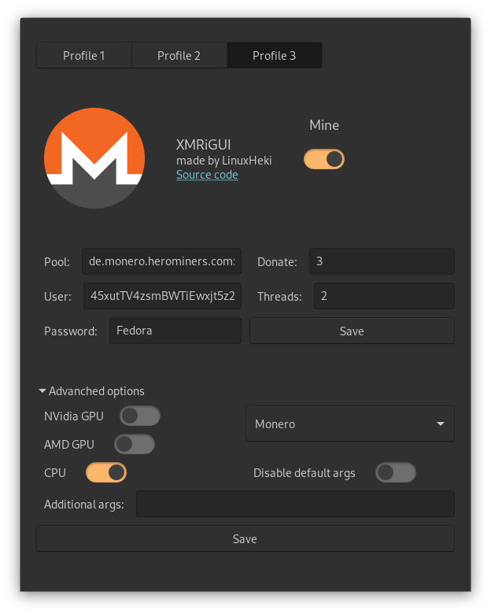

# XMRiGUI (Windows Native)

XMRiGUI is a free and open-source graphical user interface for the [XMRig](https://github.com/xmrig/xmrig) miner, specifically optimized for **Windows**. 

This version is a native **WPF (C#)** port of the original Python/GTK3 application by **FreetimeMaker**, designed to provide a seamless, high-performance mining experience without the need for Python or complex GTK dependencies.



## Key Features

### Modern Windows UI
*   **Native WPF Interface**: Built with C# and .NET Framework 4.8 for maximum performance and stability on Windows.
*   **Monero Dark Theme**: A sleek, Monero-inspired design with orange highlights and a sidebar-based navigation.
*   **System Tray Integration**: Minimize or close the app to the system tray to keep mining unhindered in the background. Uses a native `.ico` icon for the tray and window.

### v1.0.0 Mining Logic
*   **Multi-Profile Support**: Manage and run up to **3 independent mining profiles** simultaneously.
*   **Dynamic Argument Generation**: Configures `xmrig` on-the-fly via command-line parameters, ensuring compatibility and flexibility.
*   **Bundled Miner Support**: Automatically detects `xmrig.exe` in the application root or `miner/` subfolder.
*   **Real-time Telemetry**: Live Hashrate (H/s), Shares (Accepted/Rejected), and console log output per profile.

### Intelligence & Updates
*   **Automatic Update Check**: Automatically checks GitHub for the latest XMRiGUI releases and miner updates upon startup.
*   **Persistence**: Securely saves all configurations in `%APPDATA%\XMRiGUI\xmrigui.json`.

## Installation

### Binary Release
1. Download the latest `XMRiGUI.exe` or installer from the [Releases](https://github.com/FreetimeMaker/XMRiGUI-Windows/releases) page.
2. Extract or install to a folder of your choice.
3. Ensure `xmrig.exe` is present in the `miner/` folder or the root directory.
4. Run `XMRiGUI.exe`.

> [!WARNING]
> **Security & Antivirus**
>
> *   **SmartScreen**: Windows may show a "Protected your PC" warning. Click **"More Info"** -> **"Run Anyway"**. This is common for unsigned open-source tools.
> *   **Antivirus/Windows Defender**: Mining software is frequently flagged as a PUA (Potentially Unwanted Application). You may need to add an exclusion for the `XMRiGUI` folder and `xmrig.exe`.

## Build from Source

To build XMRiGUI yourself, you will need **Visual Studio 2022** (or later) with the **.NET Desktop Development** workload.

1. Clone the repository:
   ```bash
   git clone https://github.com/FreetimeMaker/XMRiGUI-Windows.git
   ```
2. Open `XMRiGUI.sln` in Visual Studio.
3. Restore NuGet packages (specifically `Newtonsoft.Json`).
4. Set the configuration to **Release**.
5. Build the solution. The output will be in `bin/Release/`.

## Command Line Options
*   `start`: Start mining all active profiles immediately.
*   `stop`: Stop all active mining processes.

## Contribute

### Support the Project
If you find this tool useful, consider supporting development:
*   **Monero (XMR)**: `49szz88CqMWGgyDxp7VqvBS62pGLQcV4YPSBHcLwtxAXLz1Wngf8vW6is4w13Au7C2RovrTiJQaGDV5VBhFnyMBsM44Pn2P`

### Feedback
Bug reports and pull requests are welcome on [GitHub](https://github.com/FreetimeMaker/XMRiGUI).

---
**Disclaimer**: Cryptocurrency mining is hardware-intensive. Ensure your system has adequate cooling. Use this software at your own risk. The developers are not responsible for any hardware damage or lost revenue.
